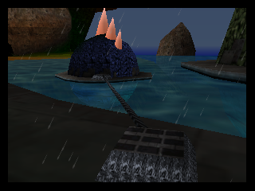
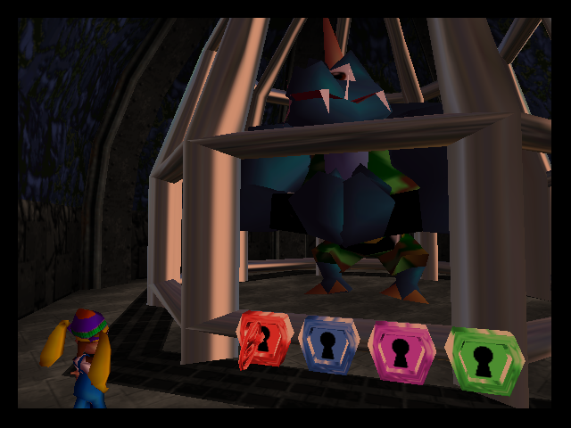
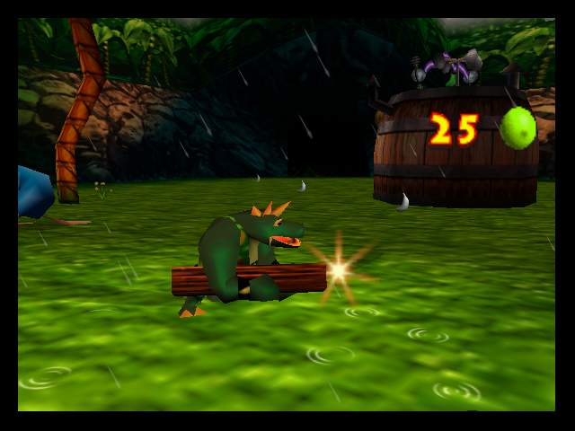
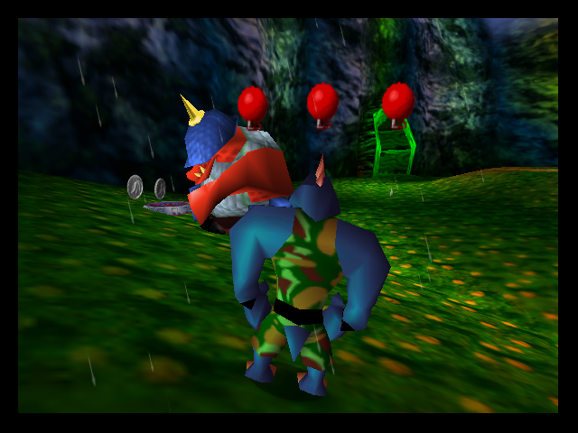
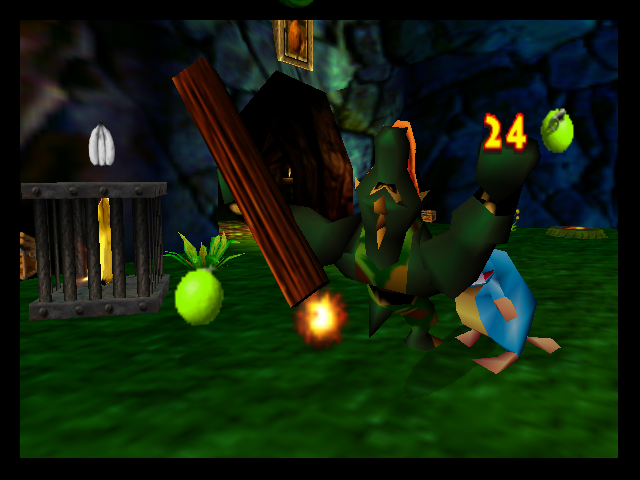
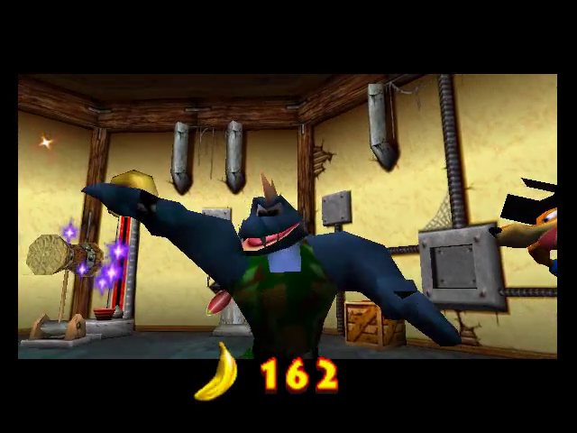
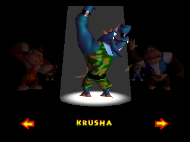
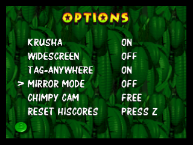

# Donkey Kong 64 · Krusha Expansion

**Recruit Krusha as the sixth playable character in Donkey Kong 64.** The Kremling from Battle Mode has a cell of his own on DK Isles. Get him out and he’ll take his place in the tag barrel, put Funky’s bazooka to work, and help himself to a share of the bananas. His adventure adds **24 Golden Bananas** across the seven main worlds and DK Isles.

**[Download the latest published BPS patch](https://github.com/AuryArthan/DK64-Krusha-Expansion/releases/latest/download/DK64-Krusha-Expansion.bps)** · [How to play](#how-to-play) · [Build and modify the hack](CONTRIBUTING.md)

## Five Kongs, five keys

Look for the small prison offshore. The prisoner has a rather questionable story about how he got there. His cage has five colored locks. Each original Kong can find a matching key on DK Isles once that Kong is free. Check **Colored Keys** in the pause menu to see whose key is still out there.

When the fifth lock opens, Krusha takes his place in the tag barrel, and his silver collectibles appear around the islands.

| The little prison off DK Isles | Diddy’s key turns in the red lock |
| --- | --- |
|  |  |

## Give a Kremling a bazooka

Funky will sell Krusha a **bazooka**. Its lime-green rounds explode on impact. Ammo crates feed the bazooka, leaving his throwable oranges available for a different kind of trouble.

Candy gives him a free voice lesson. His **Primitive Roar** clears nearby enemies, like other Kongs instruments. Use it on a pad bearing Krusha’s face to summon **Big Klump**.

Big Klump throws three red grenades in a low arc. A grenade or a belly hit costs two watermelon slices, and a punch won’t stop him mid-attack.

| Krusha opens fire in Jungle Japes | Big Klump’s three-grenade volley in Fungi Forest |
| --- | --- |
|  |  |

Krusha can lift boulders, ride Bananaports, photograph Banana Fairies with the shared camera, fight for Battle Crowns, and feed his silver bananas to Troff ’n’ Scoff to help open the boss door.

## Follow the silver bananas

Krusha has **350 silver bananas** to find, 50 in each of the seven main worlds. Follow the singles through tunnels and along trails, look up for bunches, and keep the bazooka handy for balloons. There are **63 silver coins**, that give him his own money to spend.

Each main world **and DK Isles** holds three Golden Bananas for him. A silver-haired Kasplat, Big Klump, and a caged Golden Banana. The pause menu tracks Krusha’s haul alongside the other five. Krusha’s collectibles bring full completion to **111%**.

Your first victory over K. Rool unlocks a surprise back on DK Isles.

| A beaver can still get ya | A blueprint payday at Snide’s HQ |
| --- | --- |
|  |  |

## Play your way

A fresh game starts with **Krusha enabled**, **tag barrels required**, and the original **4:3** view. The title screen’s Options menu lets you change the following independently.

| Option | What it does |
| --- | --- |
| **Tag-Anywhere** | **OFF** forces you to use tag barrels, like vanilla. **ON** also lets you cycle through unlocked characters with the D-pad. **Speed Mode** adds fast starts, moves and cutscene shortcuts. With Krusha enabled, it permanently grants his rescue on the active file, so choose OFF or ON to play the key hunt. |
| **Widescreen** | Adapts the game to 16:9, including HUD and pause sprites, tag-barrel entry and instrument cameras. |
| **Mirror Mode** | Flips the world and its controls left to right while keeping dialogue, counters and signs readable. Many details were considered so that everything reads the right way round. |
| **Krusha** | Switch him off to play with the original five. You can still use Tag-Anywhere, Widescreen and Mirror Mode. |

| Krusha’s place in the tag barrel | The Options barrel |
| --- | --- |
|  |  |

## How to play

1. Apply the **Krusha Expansion BPS patch** to a clean, big-endian **Donkey Kong 64 (USA)** ROM (`.z64`) with a BPS patcher such as Floating IPS. The source ROM’s SHA-1 is `CF806FF2603640A748FCA5026DED28802F1F4A50`.
2. Open the patched ROM in **Mupen64Plus with Glide64mk2**, or **Mupen64Plus-Next with GLideN64** in RetroArch. Use **8 MB Expansion Pak**, **EEPROM 16K** and **CountPerOp = 1**. Keep framebuffer emulation enabled with GLideN64.
3. Start a **fresh Adventure file** for the recruitment campaign. For a 16:9 display, enable Widescreen inside DK64, set the emulator display to 16:9, and leave its separate widescreen hack off.

### Compatibility and limits

- This patch targets the USA release. Keep old saves with their respective ROMs, and load emulator states only on the exact build that created them. [Earlier Krusha + Tag Anywhere release (v0.6.1)](https://github.com/AuryArthan/DK64-Krusha-Expansion/releases/tag/v0.6.1)
- The original five retain their exclusive puzzle moves, boss assignments and banana medals. Krusha’s 50 silver bananas per world count toward his personal total and can be donated.
- Testing has focused on single-player Adventure in emulation. Original N64 hardware, multiplayer and a complete end-to-end 111% playthrough remain unverified. [Testing and compatibility](docs/testing.md)

## Behind the hack

**Arthan** directed and playtested the expansion, supplied the scream recording and title artwork, and selected and refined Krusha’s portrait. The project used **OpenAI Codex** for implementation, debugging and emulator testing, and AI-assisted artwork for the portrait.

**Isotarge and the DK crew** built the Tag Anywhere hack that this expansion grew from. Their character-switching code, Speed Mode and ROM-building tools provided its foundation. [Original Tag Anywhere project and credits](https://github.com/Isotarge/dk64-tag-anywhere)

The DK64 decompilation and recompilation projects helped identify native game behavior and engine symbols. Mirror Mode draws on the DK64 Randomizer team’s work. DonkViewer’s geometry research helped bring the Isles into the collectible placement atlas. [DK64 decompilation](https://gitlab.com/dk64_decomp/dk64) · [DK64 Recompiled](https://github.com/Rainchus/Donkey-Kong-64-Recompiled) · [Mirror Mode attribution](THIRD_PARTY.md) · [DonkViewer](https://github.com/theballaam96/DonkViewer)

**Want to modify the hack?** The repository includes a handoff skill for a fresh coding session, plus a human-readable guide to the source, build tools and gameplay tests. Start there to find the code behind a feature and the tests that cover it. [Handoff skill](.agents/skills/krusha-handoff/SKILL.md) · [Project handoff](codex_handoff/README.md) · [Build from source](CONTRIBUTING.md)

Donkey Kong 64 and its characters belong to Nintendo and Rare. The download contains the patch only.

[License for the expansion contributions](LICENSE.md) · [Third-party notices](THIRD_PARTY.md)
